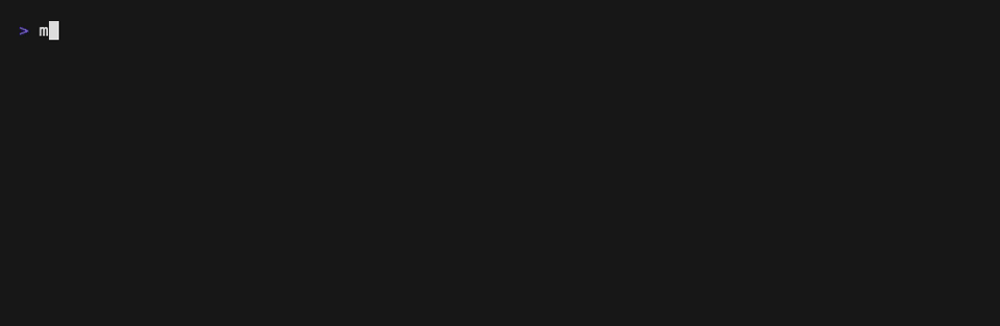

# Moodle CLI

This is a tool for S.P.I.T students to use `moodle.spit.ac.in` in the terminal. Its really frustating to use that site and to miss out on a deadline because its lost in the 100s of other batch assignments. This tool gets you assignments relevant only to you.



## What it does

- Fetches your deadlines from Moodle (the same list as the dashboard Timeline)
- Splits them into two tabs: **Upcoming** and **Overdue** (unsubmitted work from the last 14 days)
- Hides assignments meant for other batches, so `E8-B2-T1` disappears if you're in A4
- Keeps whole-class assignments (ones with no batch tag, like `Assignment 8`)
- Shows how much time is left, colored by urgency (red < 1 day, yellow < 3 days, green after that)
- Opens the selected assignment in your browser with `enter`

## Requirements

- Go 1.26+
- A S.P.I.T Moodle account

## Setup

### 1. Install

```
git clone https://github.com/ohhmkar/moodle-cli.git
cd moodle-cli
go install .
```

This puts `moodle-cli` in `~/go/bin`. If your terminal says `command not found`, add that folder to your `PATH`:

```
echo 'export PATH="$PATH:$HOME/go/bin"' >> ~/.zshrc
```

### 2. Log in

```
moodle-cli login
```

Enter your Moodle username and password. The password isn't shown as you type, and it's never saved. It's only sent once to Moodle to get a token.

The token is saved to:

| OS | Location |
|---|---|
| macOS | `~/Library/Application Support/moodle-cli/token` |
| Linux | `~/.config/moodle-cli/token` |
| Windows | `%AppData%\moodle-cli\token` |

> Your token works like your password. Don't share it or commit it. If it leaks, reset it in Moodle under **Preferences → Security keys**, then run `moodle-cli login` again.

### 3. Set your batch

```
echo 'export MYBATCH=A4' >> ~/.zshrc
```

Replace `A4` with your batch (A1–D4), then open a new terminal.

### 4. Run

```
moodle-cli
```

## Controls

| Key | Action |
|---|---|
| `↑` / `k` | move up |
| `↓` / `j` | move down |
| `enter` / `o` | open in browser |
| `tab` / `t` | switch between Upcoming and Overdue |
| `r` | refresh |
| `q` / `ctrl+c` | quit |

## How batch filtering works

Assignment names carry a batch tag (A1–D4) in a few different formats:

| Format | Example |
|---|---|
| between dashes | `E8-A4-T2 (FM)` |
| at the start | `A1-Application-...`, `A1W9T2` |
| after a number | `E5C3T1`, `W6A4T2` |
| as a word | `Batch A4` |

An assignment is hidden only if it has a batch tag that isn't yours. Anything without a tag is shown. If a professor uses a new naming format, the assignment will show up rather than get hidden, so you won't miss anything.

## Development

```
go vet ./...
go test ./...
go run .
```

`MOODLE_TOKEN` overrides the saved token if it's set, which is handy for testing with a different account.
